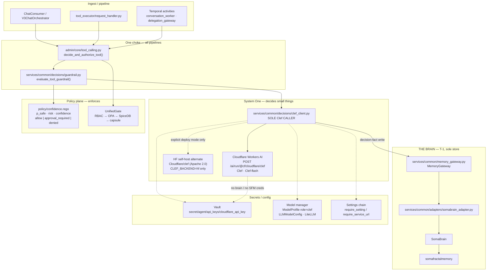

# SOMA-ARCH-CLEF-001 — Cloudflare Clef as the System One decision layer (replaces OpenJev)

## Document Control

| Field | Value |
|---|---|
| Document Title | Cloudflare Clef / Clef-flash as the SomaAgent01 System One decision layer |
| Document Identifier | SOMA-ARCH-CLEF-001 |
| Version | 1.1.0 |
| Date | 2026-10-09 |
| Status | Draft |
| Author | SomaTech Engineering |
| Approver | — |
| Classification | Internal |
| ISO Reference | ISO 9001:2015; ISO/IEC/IEEE 29148:2018; ISO/IEC 25010:2011 |
| Next Review | 2027-01-09 |
| Related | `SOMA-ARCH-INVARIANTS-001`, `SOMA-ARCH-TOOLS-001`, `SOMA-STD-CONFIG-001`, `SOMA-PM-PLAN-CLEF-INTEGRATION-001`, `SOMA-PM-JEV-PIN-001` (obsolete), `SOMA-PM-PLAN-JEV-INTEGRATION-001` (obsolete) |
| Source of truth | Live SA01 tree (services/common/decisions/, admin/modules/mod_clef/, policy/confidence.rego, admin/core/tool_calling.py, config/settings.py) + Cloudflare blog *Introducing Clef* (2026-10-01) |
| Scope | Architecture for Cloudflare Clef as the System One decision layer. OpenJev removed. W-C1 + W-C2 code is live in-tree. |
| Audience | Operator (binding), soma-clef-engineer (implementer), peer agents (A2A) |

## Revision History

| Version | Date | Author | Description |
|---|---|---|---|
| 1.0.0 | 2026-10-09 | MiMoCode-architect | Initial issue. Decision: adopt Cloudflare Clef/Clef-flash as System One (replaces OpenJev). Capability placement, contract map, fail-closed matrix, phased rollout W-C0…W-C6. Docs-only at issue. |
| 1.1.0 | 2026-10-09 | triad-iso-docs | Truth-pass after W-C1 + W-C2 landed. Document Control brought to house style. Status corrected from "PROPOSED — docs only" to Draft (code is live). Section F updated from "to rebuild" to as-built inventory. Section H waves marked done where code exists. Related documents corrected. |

---

## 0. Operator order (binding) — as received 2026-10-09

1. **REMOVE all OpenJev code and integrations** from somaAgent01. *(DONE — LEDGER 19:10)*
2. **Adopt Cloudflare Clef** (https://blog.cloudflare.com/clef-decision-models/) as the decision model. *(DONE — W-C1 + W-C2 live in-tree)*
3. Product law: **ALL data through THE BRAIN** (MemoryGateway → SomaBrain → SFM). **T-1**. **Fail-closed**. **NO shims/mocks/fakes**. **No hardcoded models** — model manager + settings chain.

> **OPA enforces. V3 orchestrates. Temporal endures. SomaBrain remembers and thinks (System Two). Clef only decides small things — and every decision it makes is a fact in THE BRAIN, or it did not happen.**

---

## A. VERDICT

Three options scored against SA01's actual need: a typed, fast, fail-closed producer of `p_safe` / `risk` / `confidence` for the tool choke and later triage — without owning memory, authz, or chat.

| Dimension (weight) | **Cloudflare Clef / Clef-flash** | **OpenJev** | **Stay without System One** |
|---|---|---|---|
| API contract fit (20%) | **10** — Jev-API compatible (`state` + `questions` with `noul`/`choice`/`score`, criteria maps/lists). The Jev-shaped contract map already designed in ARCH-JEV-002 §5 carries over unchanged. | 9 — this *is* the Jev contract (it is the reference impl) | 0 — nothing produces typed P(safe)/severity |
| Latency, tool-boundary hot path (20%) | **9** — Clef-flash median **38.8 ms**, p95 **122.4 ms**; Clef median **209.3 ms**, p95 **238.6 ms** (Workers AI edge GPUs) | 3 — Jev median **524.1 ms**, p95 **536.0 ms**. Too slow to sit on the tool choke. | n/a |
| Quality on decision benches (15%) | **9** — leads Jev Decision Index on BFCL (98.47/98.76 vs 95.75), ToolRet (69.19 vs 65.28), API-Bank (91.93/93.11 vs 88.19), BANKING77 (94.20 vs 79.74), CLINC150+OOS (97.43 vs 89.27), ESCI (57.48 vs 55.21). Loses When2Call, BRIGHT, agent-trace, PhishNChips. | 7 — good, but consistently behind Clef on the benches SA01 cares about (tool call / intent / routing) | 0 |
| Ops / installability (15%) | **9** — hosted `POST /ai/run/@cf/cloudflare/clef`; **or** Apache-2.0 weights on HF (`Cloudflare/clef`, `Cloudflare/clef-flash`) for self-host | 4 — real dependency already proved painful: HF load **fail-closed on CPU** (mxfp4 needs GPU — evidence `docs/iso/evidence/JEV-WP-2/hf-load-attempt-20261009.md`, LEDGER 18:40). No Workers-AI-class hosting. | 10 — nothing to run, nothing to decide |
| Capability ceiling (10%) | **9** — 64k context (vs Jev 32k), **vision encoder** (images), non-autoregressive schema scoring, RL fine-tune platform later | 6 — text-only, 32k | 0 |
| Residency / trust (10%) | 6 — requests leave the perimeter to Cloudflare (see G-R1). Mitigations exist; the operator must accept or choose self-host. | **8** — runs in-perimeter once the GPU problem is solved | **10** — no egress |
| Migration cost from today (10%) | **9** — OpenJev code is **already deleted** from the tree (LEDGER 19:10). Jev-API compatibility means the contract, OPA input, and DecisionSignals design survive. | 2 — reinstating a just-deleted stack against an operator removal order | 5 — no work, but leaves `confidence.rego` with a permanent fail-closed hole |
| **Weighted score** | **8.7 / 10** | **5.6 / 10** | **3.2 / 10** |
| **Verdict** | **GO — Clef is the System One layer** | **NO-GO — removed by operator order; also too slow** | **NO-GO — `policy/confidence.rego` already fails closed when `decision_guard=true`; without a producer, every guarded tool call is denied or human-gated forever** |

**Decision: ADOPT Cloudflare Clef / Clef-flash as the System One decision layer.**

Two hard conditions (not objections — release criteria):

1. **W-C1 must pin the live Workers AI request/response schema** by a real call (or the HF `inference` snippet) before any code depends on field names. The blog example is authoritative *for shapes*, not for every response field. Contract tests freeze it.
2. **The egress question (I-1) is answered by the operator** before W-C2 lands in production. Design supports both; the operator picks.

Why not "no System One": `policy/confidence.rego` is already written fail-closed (`decision_guard == true` ⇒ `p_safe` mandatory). That policy is live architecture. Without a producer, guarded tools never auto-run. That is not a neutral choice — it is a permanent half-built safety plane. Something must produce the evidence. Clef is the best available producer.

---

## B. TARGET ARCHITECTURE

### B.1 Recommendation: one primary, one *explicit* alternate, zero silent fallback

| Slot | Choice | Why |
|---|---|---|
| **PRIMARY runtime** | **Cloudflare Workers AI hosted Clef / Clef-flash** — `POST https://api.cloudflare.com/client/v4/accounts/{account_id}/ai/run/@cf/cloudflare/clef` (Bearer token) | Edge GPU latency is the product (Clef-flash 38.8 ms median). No GPU ops in SA01. Enterprise guarantee: Cloudflare states it does not read, store, or train on requests/responses (except opt-in fine-tuning). Apache-2.0 weights remain available if that guarantee changes. |
| **Model split** | **Clef-flash** on the **tool-guardrail choke** (latency-critical, 1–3 questions). **Clef** on **async triage / multi-question / vision** (Temporal, delegation gateway). Both selected via the model manager — never hardcoded. | Flash's p95 of 122 ms fits a tool boundary; Clef's extra quality belongs where 200 ms is free. |
| **ALTERNATE deployment** | Self-hosted **HF `Cloudflare/clef` / `Cloudflare/clef-flash`** (Apache 2.0) behind the *same* `ClefClient`, selected by `CLEF_BACKEND=hf` in the settings chain | For data-residency tenants / air-gapped deploys. **Not a hot fallback** — a deployment mode. |
| **Fallback policy** | **NONE. Fail-closed.** Timeout, 4xx/5xx, missing token, unconfigured model, schema drift ⇒ `DecisionSignals` is *absent* ⇒ choke returns `approval_required` (tier-2) or `denied` (tier-3). Never a second model, never a rule-based "looks safe" stub, never a cached decision. | Product law. A silent fallback is a shim. |

> **Naming:** the blog endpoint model path is `@cf/cloudflare/clef`. The request body also carries `"model": "clef"` in the published example. W-C1 verifies which of the two is authoritative and freezes the one true shape in `services/common/decisions/contracts.py`. Do not ship both spellings.

### B.2 Diagram



### B.3 First-ship cut

**W-C0 (removal/cleanup) + W-C1 (client + contract + brain write) + W-C2 (guardrail choke).** Nothing else. No `clef_decide` tool. No router tie-break. No triage badges. Those wait for golden-set evidence.

---

## C. CAPABILITY PLACEMENT

Clef decides **small typed things**. It does not own memory, authz, chat, or enforcement.

| # | Capability | Owner (authority) | Clef's role | Explicitly NOT Clef |
|---|---|---|---|---|
| 1 | Chat / free-text generation | **Chat LLM via V3 / model_router** | none | never a second LLM pass |
| 2 | Tool selection / ranking | **V3 Phase 7 rules floor** (+ later Clef `choice` tie-break, W-C3) | optional closed-world `choice` over tool names | not the only selector; not open-world |
| 3 | Tool guardrail / approval evidence | **OPA (`confidence.rego`) enforces** + UnifiedGate | produces `p_safe` (`noul`), `risk` (`score`), `confidence` — evidence only | **never enforces**. No Clef verdict is an allow. |
| 4 | Authorization | **UnifiedGate (RBAC → OPA → SpiceDB → capsule scope)** | none | never |
| 5 | Model routing constraints | **`admin/core/model_router.py` `select_model`** rules | later `choice` tie-break when \|candidates\| > 1 (W-C3) | not the router |
| 6 | Urgency / severity triage | **Clef `score`** on ordered legend (W-C3) | `score` → `risk` | not regex, not chat LLM, not `context_evaluate` |
| 7 | Escalation to human | **Clef `noul` signal + `should_flag` + human authority** | signal only | never auto-closes |
| 8 | Long-term memory | **MemoryGateway → SomaBrainAdapter → SomaBrain → SFM (T-1)** | none | never holds a store |
| 9 | Working / session state | **Brain namespace via MemoryGateway** | none | no private scratch |
| 10 | Decision audit | **Brain `clef.decisions.*` fact + outbox envelope** | emits the fact payload | no local decision DB, no log-as-truth |
| 11 | Async / durable workflows | **Temporal** (`services/conversation_worker/temporal_worker.py`, `services/delegation_gateway/temporal_worker.py`) | called from activities as a client | never owns the workflow |
| 12 | Cognitive context eval | **SomaBrain `context_evaluate` (System Two)** | none | never |
| 13 | Neuromodulators / reward / sleep | **SomaBrain** | none | never |
| 14 | Secrets | **Vault** (`secret/agent/api_keys/*`, `secret/agent/credentials/*`) | consumed via `get_secret_manager()` | never sees brain/SFM creds |

**Invariant:** a Clef call can only **tighten** a dangerous action versus the legacy path. Loosening requires a human override that is itself a brain-persisted decision-fact.

---

## D. CLEF CONTRACT MAP

### D.1 Published request shape (blog, authoritative for shapes)

```json
{
  "model": "clef",
  "state": "Checkout has been failing for every customer for the last hour.",
  "questions": {
    "urgent": { "type": "noul", "instructions": "Is this support request urgent?" },
    "team": {
      "type": "choice",
      "instructions": "Which team should handle this request?",
      "criteria": {
        "billing": "Payments, invoices, and refunds",
        "technical": "Outages, errors, and configuration",
        "sales": "Plans and upgrades"
      }
    },
    "severity": {
      "type": "score",
      "instructions": "How severe is the customer impact?",
      "criteria": ["No impact", "Minor", "Major", "Critical"]
    }
  }
}
```

- `choice.criteria` = **map** (label → definition).
- `score.criteria` = **ordered list** (legend).
- `noul` has no criteria.
- `state` is a single text blob (64k context ceiling). Vision: images accepted (exact media encoding is a **W-C1 freeze item** — see I-4).

### D.2 Response → `DecisionSignals` (SA01)

Same split as `SOMA-ARCH-JEV-002` §5. **This is the contract that survived the swap because Clef is Jev-API compatible.**

| Clef field | Meaning | Maps to | Never |
|---|---|---|---|
| `questions.<id>` where `type=noul` → `.noul` | **P(true)**, e.g. P(safe) | `DecisionSignals.p_safe` | never `confidence` |
| `questions.<id>` where `type=score` → `.score` | expectation on the ordered legend | `DecisionSignals.risk` (normalize legend index to the rego scale) | never a free float invented by us |
| `questions.<id>` where `type=score` → `.confidence` | 1 − normalized entropy | `DecisionSignals.confidence` | — |
| `questions.<id>` where `type=choice` → `.choice` + `.probabilities` | closed-world pick | routing inputs + audit fact | never open-ended labels |
| `questions.<id>` where `type=choice` → `.confidence` | 1 − normalized entropy | `DecisionSignals.confidence` (per-question) | — |

**Rule (carried verbatim from C-1):** *never feed `noul` into `confidence`.* Mid-range P(safe) is not "model unsure."

### D.3 `DecisionSignals` (normative — `services/common/decisions/contracts.py`)

**As-built** (the live dataclasses in `contracts.py` — this section was updated in v1.1.0 to match the frozen implementation):

```python
# services/common/decisions/contracts.py — frozen shapes (see file for full defs)
DecisionSignals:
    p_safe: float | None          # from noul
    risk: float | None            # from score
    confidence: float | None      # from choice/score .confidence (entropy split)
    choice: str | None
    choice_probabilities: dict[str, float] | None
    score_probabilities: dict[str, float] | None
```

`present=False` is a first-class state. Callers must not treat `None` fields as "fine."

### D.4 OPA input contract (unchanged from ARCH-JEV-002 §5.2 — already implemented)

```json
{
  "action": "tool.request",
  "tenant": "<uuid>",
  "resource": "<tool_name>",
  "confidence_enabled": true,
  "treat_null_as_low": true,
  "min_acceptance": 0.5,
  "p_safe": 0.12,
  "risk": 2.4,
  "confidence": 0.41,
  "confidence_status": "critical|low|acceptable",
  "decision_guard": true,
  "clef_present": true,
  "clef_decision_id": "<brain-fact id>"
}
```

`policy/confidence.rego` **already** consumes `p_safe` / `risk` / `confidence` and emits `outcome ∈ {allow, approval_required, denied}`. **W-C0 only renames the `jev_*` rule identifiers and comments to `clef_*` / `decision_guard`** — the thresholds and fail-closed semantics stay byte-stable. Rename is cosmetic; do not retune thresholds in W-C0/W-C2.

### D.5 Numeric thresholds (first ship — same as ARCH-JEV-002 §5.3)

| Condition | Effect |
|---|---|
| `p_safe` null (Clef missing/down/timeout) and tool tier-3 | **denied** (never silent allow) |
| `p_safe` null and tool tier-2 | **approval_required** |
| `p_safe` < 0.30 | **denied** tier-3 · **approval_required** tier-2 |
| `p_safe` 0.30–0.70 | **approval_required** |
| `p_safe` > 0.70 and `risk` ≤ 1 | allow (tier-1/2) |
| `risk` ≥ 2 | always **approval_required** regardless of `p_safe` |
| `confidence` < 0.30 | `should_flag` + treat as low evidence |

Until calibration (W-C5): **tier-3 always keeps human approval** even at high `p_safe`.

### D.6 Decision-fact → THE BRAIN (mandatory)

**Every Clef call that informs a decision produces exactly one brain write. No brain write ⇒ the decision did not happen ⇒ tier-3 stays blocked.**

| Data | Write path (only) | Read path (only) |
|---|---|---|
| User turns / replies | V3 → MemoryGateway → SomaBrain → SFM | Phase 5 recall |
| Working state | MemoryGateway `session.working.*` | MemoryGateway |
| Clef input `state` | built by caller from recalled memory | MemoryGateway.recall |
| **Clef decision-fact** | **clef_client → MemoryGateway `clef.decisions.*` + outbox envelope** | recall / UI / calibration |
| Calibration sets | Artifacts summarized → brain | Temporal via recall |

**No Clef disk, DB, Redis, or decision cache in SA01.** The Workers AI call is stateless.

**Decision-fact schema** (brain payload):

```
decision_id, tenant_id, trace_id, mode(noul|choice|score), question_id,
payload{p_safe|risk|choice, probabilities, confidence}, input_state_digest,
caller(v3|conversation_worker|temporal), model_id, backend(workers_ai|hf),
latency_ms, outcome(auto_execute|approval_required|denied|advisory),
opa_decision_ref, created_at
```

`input_state_digest` = hash of the `state` string. **No raw tool args, no secrets, no monologue in the fact.**

Outbox: reuse the existing T-6 pattern (`durable_accept_memory` / `memory.wal` / memory-replicator). Outbox OK + brain write fail ⇒ decision not saved ⇒ retry/DLQ; tier-3 stays blocked.

---

## E. INTEGRATION SEAMS (live attach points)

| Seam | Live path | Status |
|---|---|---|
| **Shared client (sole caller)** | `services/common/decisions/decision_client.py` | **LIVE** — `DecisionClient.decide()`; all pipelines go through it |
| Clef HTTP client | `services/common/decisions/clef_client.py` | **LIVE** — `ClefClient.decide()` → Workers AI `POST /ai/run/{model_id}` |
| Contracts | `services/common/decisions/contracts.py` | **LIVE** — `DecisionSignals`, `ClefAnswer`, `ClefResponse`, `DecisionFact`, signal mapping |
| Guardrail helper | `services/common/decisions/guardrail.py` | **LIVE** — `choke_tool_call()` → signals + OPA input assembly |
| **B choke** | `admin/core/tool_calling.py` → `decide_and_authorize_tool()` | **LIVE** — calls `choke_tool_call` (line ~302); fail-closed on exception |
| OPA feed | `policy/confidence.rego` | **LIVE** — `p_safe`, `risk`, `confidence`, `decision_guard` inputs; fail-closed deny when `p_safe` null |
| AuthZ | `admin/core/agentiq/unified_gate.py` `UnifiedGate` | **LIVE** — unchanged, still the enforcer. Clef never replaces it |
| Module shell | `admin/modules/mod_clef/module.yaml` | **LIVE** — `feature_flag: clef_decide`, `permissions: [network, vault:read]` |
| Settings chain | `config/settings.py:393-396` | **LIVE** — `CLEF_API_BASE`, `CLEF_ACCOUNT_ID`, `CLEF_MODEL_ID`, `CLEF_TIMEOUT_MS` |
| Secrets | Vault via `services/common/unified_secret_manager.py` `get_secret_manager()` | **LIVE** — `get_provider_key("cloudflare")`; token never in git/ENV steady state |
| Memory (T-1) | `services/common/memory_gateway.py` → `MemoryGateway.remember()` | **LIVE** — decision-fact writes in `DecisionClient._persist_fact()` |
| Feature flags | `admin/core/config.registry.get_feature_flag` | **LIVE** — `clef_decide`, `clef_guardrail`; fail-closed (unset = off) |

**Named choke insertion points (must all call the same helper):**

1. Chat path — inside `decide_and_authorize_tool` before `gate.check()`.
2. Kafka path — `services/tool_executor/request_handler.py` (already shares the choke).
3. Temporal activities that execute tools — same helper.

### E.1 Settings keys (all required, no defaults — R-VAL-04)

| Key | Layer | Notes |
|---|---|---|
| `CLEF_BACKEND` | settings | `workers_ai` (default deployment) \| `hf`. Empty ⇒ refuse to call ⇒ fail-closed |
| `CLEF_API_BASE` | `require_service_url` | e.g. `https://api.cloudflare.com/client/v4`. **No hardcoded URL in code.** |
| `CLEF_ACCOUNT_ID` | `require_setting` | Workers AI path segment |
| `CLEF_MODEL_ID` | `require_setting` **after** `ModelProfile(role="clef")` resolution | `@cf/cloudflare/clef` or `@cf/cloudflare/clef-flash` or HF repo id |
| `CLEF_TIMEOUT_MS` | `require_setting` | choke budget; default candidate 400 (flash) / 800 (clef) — set by operator, not by a literal |
| `CLEF_MAX_STATE_CHARS` | `require_setting` | fat-state guard (R-6) |
| Vault `cloudflare_api_key` | `get_credential` / `get_secret_manager` | Bearer token |

### E.2 Feature flags

```
clef_decide      — master switch for the shared client (default False)
clef_guardrail   — tool-choke evidence (depends on clef_decide)
```

**Flag off / unset ⇒ `DecisionSignals.present = False` ⇒ tier-3 denied, tier-2 approval_required.** Flag-off is not "legacy allow" for guarded tools (ARCH-JEV-002 ADV fix, carried forward).

---

## F. AS-BUILT INVENTORY (truth-passed 2026-10-09)

### F.1 REMOVED (OpenJev — operator order item 1)

| Artifact | Status | Evidence |
|---|---|---|
| `services/common/decisions/` (OpenJev contracts, decision_client, guardrail, groq_backend) | **DELETED** | LEDGER 19:10; live tree contains Clef-only files |
| `admin/modules/mod_jev/` | **DELETED** | LEDGER 19:10 |
| `tests/unit/test_jev_*.py`, `tests/proofs/test_jev_guardrail_golden.py` | **DELETED** | LEDGER 19:10 |
| `scripts/jev_hf_evidence.py` | **DELETED** | LEDGER 19:10 |
| `requirements.txt` / `pyproject.toml` openjev pin | **GONE** | no `openjev` string in either file |
| `JEV_*` in `config/settings.py` | **GONE** | only `CLEF_*` remain (settings.py:393-396) |
| `jev_decide` / `jev_guardrail` feature flags | **GONE** | replaced by `clef_decide` / `clef_guardrail` |
| `policy/confidence.rego` rule names | present (`jev_required`, `conf_required`) | rename to `decision_guard_required` is a tracked non-blocking cleanup; **semantics are live and fail-closed** |

### F.2 LIVE (Clef — as-built)

| Artifact | Path | Status |
|---|---|---|
| Contracts | `services/common/decisions/contracts.py` | **LIVE** — `ClefAnswer`, `ClefResponse`, `DecisionSignals`, `DecisionFact`, `map_answers_to_signals`, `outcome_from_signals`, `should_flag` |
| Client | `services/common/decisions/clef_client.py` | **LIVE** — `ClefClient.decide()` POSTs `{model, state, questions}` to `CLEF_AI_RUN_PATH`; fail-closed on missing token/settings |
| Decision client | `services/common/decisions/decision_client.py` | **LIVE** — `DecisionClient.decide()` sole caller; mandatory brain write via `MemoryGateway.remember`; `clef_flag_enabled("clef_decide")` |
| Guardrail | `services/common/decisions/guardrail.py` | **LIVE** — `choke_tool_call()` tighten-only; tier sets TIER1/2/3; `opa_input_from_signals()` |
| Module | `admin/modules/mod_clef/module.yaml` | **LIVE** — `feature_flag: clef_decide`, `permissions: [network, vault:read]` |
| Choke wiring | `admin/core/tool_calling.py` `decide_and_authorize_tool()` | **LIVE** — calls `choke_tool_call` (line 302-307); fail-closed on exception |
| OPA | `policy/confidence.rego` | **LIVE** — consumes `p_safe`/`risk`/`confidence`/`decision_guard`; fail-closed deny when `p_safe` null |
| Settings | `config/settings.py:393-396` | **LIVE** — `CLEF_API_BASE`, `CLEF_ACCOUNT_ID`, `CLEF_MODEL_ID`, `CLEF_TIMEOUT_MS` via `os.environ` |
| Brain namespace | `contracts.decision_fact_namespace()` | **LIVE** — `clef.decisions.{category}` |
| Tests | `tests/unit/test_clef_*.py` | present in tree (see test suite) |

### F.3 RENAME / REWORD (completed or tracked)

| Item | From | To | Status |
|---|---|---|---|
| Agent profile | `.mimocode/agent/soma-jev-engineer.md` | `.mimocode/agent/soma-clef-engineer.md` | **DONE** |
| Agent name in `CLAUDE.md` | `soma-jev-engineer` | `soma-clef-engineer` | **DONE** |
| Brain namespace | `jev.decisions.*` | `clef.decisions.*` | **DONE** |
| Feature keys | `jev_*` | `clef_decide`, `clef_guardrail` | **DONE** |
| Rego rule ids | `jev_required` | `decision_guard_required` | **TRACKED** — rename is cosmetic; thresholds/semantics unchanged |

---

## G. RISKS + FAIL-CLOSED MATRIX

| ID | Risk | Likelihood | Impact | Mitigation / fail-closed |
|---|---|---|---|---|
| **G-R1** | **Network egress to Cloudflare** — tool state (digested) leaves the perimeter | certain (workers_ai mode) | High (residency) | (a) `input_state_digest` only in the fact; no raw args, no secrets in `state`; (b) `CLEF_MAX_STATE_CHARS`; (c) operator chooses `CLEF_BACKEND=hf` for residency tenants; (d) Cloudflare's no-read/no-store/no-train guarantee is contractual — re-verify annually. **I-1 is the operator gate.** |
| **G-R2** | **Data residency / tenancy** — multi-tenant SA01 sending tenant state to a third party | medium | High | Per-tenant backend override in the settings chain (Capsule → AgentSetting → SettingsModel). Tenants requiring residency get `hf` or get `decision_guard` off (⇒ fail-closed approval). |
| **G-R3** | **Token / cost drift** — Workers AI bills per neuron | medium | Med | Budget alerting on the Cloudflare account; `CLEF_TIMEOUT_MS` keeps retries at zero; choke is tool-boundary only (not per-token chat). |
| **G-R4** | **Offline / Cloudflare outage** | low–med | High | **Fail-closed**: timeout/5xx ⇒ `present=False` ⇒ tier-3 denied, tier-2 approval_required. There is no degraded "looks safe" path. |
| **G-R5** | **Jev-API drift** — "fully compatible" is a claim, not a test | medium | Med | W-C1 freezes the live schema with a real call; contract tests fail the build on shape change. A shape change is **Clef-down**, not a silent remap. |
| **G-R6** | **Model-id drift / accidental hardcoding** | medium | Med | `ModelProfile(role=clef)` then `require_setting("CLEF_MODEL_ID")` only. A literal model id in source is a test failure. |
| **G-R7** | **Prompt-injection via `state`** — tool args steer the decision | medium | High | `state` is built by *us* from a fixed template + digest; questions' `instructions` are code constants, not user text; Clef has no tool-calling authority; OPA still enforces. |
| **G-R8** | **Social engineering ("Clef said yes")** | medium | High | UI shows probabilities **and** OPA rationale; override requires a reason that is itself a brain fact. Clef never returns allow — OPA does. |
| **G-R9** | **Brain write lost** | low | High | T-6 outbox (`memory.wal`) + memory-replicator; lost fact ⇒ tier-3 blocked. |
| **G-R10** | **HF self-host CPU trap** (already hit once with OpenJev, LEDGER 18:40) | high if `CLEF_BACKEND=hf` without GPU | Med | `hf` mode is an explicit deployment with a GPU requirement in the runbook; boot check fails closed naming the missing capability. |
| **G-R11** | **Dual-pipeline drift** (two call sites, two shapes) | medium | Med | Sole client (`clef_client.py`); a second caller is a review failure. |
| **G-R12** | **Flash vs Clef choice error** (flash too weak on a hard guardrail) | low | Med | Both selected via model manager; per-call site override through the settings chain. Golden set includes flash-vs-clef comparison. |

### G.1 Fail-closed matrix (normative)

| Condition | D-1/D-2 guardrail | D-3/D-4 router (later) | D-5 triage (later) | D-6 escalation (later) |
|---|---|---|---|---|
| Flag off / unset | tier-3 **denied**, tier-2 **approval_required** | rules | skip | if-chains |
| Clef down / timeout / 4xx / 5xx | tier-3 **denied**, tier-2 **approval_required** | rules | skip | `should_flag` |
| Schema drift (contract test fail) | **Clef-down** → same as above | — | — | — |
| Brain write failed | block tier-3 until persisted | discard advisory | discard | discard + metric |
| OPA / UnifiedGate deny | **stop before Clef** | — | — | — |
| `CLEF_MODEL_ID` unresolvable | refuse to call → same as down | — | — | — |
| Missing Vault token | refuse to call → same as down | — | — | — |

---

## H. PHASED ROLLOUT

| Phase | Work | Status | Exit criteria |
|---|---|---|---|
| **W-C0 — REMOVAL** | Purge OpenJev residue; retire JEV docs; rename rego identifiers (cosmetic); rewrite profiles | **DONE** (LEDGER 19:10 + truth-pass 2026-10-09) | `rg -i 'openjev\|mod_jev\|JEV_'` clean outside historical docs; agent profile names Clef |
| **W-C1 — CLIENT + CONTRACT** | `services/common/decisions/{contracts,clef_client,decision_client}.py`; `CLEF_*` settings; mandatory decision-fact brain write; `mod_clef` shell + flags | **DONE — LIVE IN TREE** | Schema in `contracts.py`; decision-fact recallable from brain; unconfigured ⇒ refuse (fail-closed); no literal model id/token in source |
| **W-C2 — GUARDRAIL CHOKE** | `guardrail.py` + `decide_and_authorize_tool` tighten-only wiring; OPA input assembly; tier sets | **DONE — LIVE IN TREE** | Clef can only tighten; flag-off and Clef-down both fail closed; tier-3 stays approval-gated |
| **First ship** | **W-C0 + W-C1 + W-C2** | **COMPLETE** | Operator demo on real tools |
| **W-C3 (later)** | D-5 urgency `score`, D-6 escalation `noul`, D-3 tool `choice` rank, D-4 model-router tie-break | NOT STARTED | Urgency badge; ranked tools; evidence per mode |
| **W-C4 (later)** | `clef_decide` tool exposure (deferred on purpose), vision path (I-4), per-tenant backend override | NOT STARTED | Tool gated; vision golden cases |
| **W-C5 (later)** | Temporal calibration workflow; flash-vs-clef benchmark; thresholds retune from evidence | NOT STARTED | Calibration report; thresholds justified by data |
| **W-C6 (optional)** | Cloudflare RL fine-tune on SA01 decision traces (opt-in only) | NOT STARTED | Fine-tuned model behind `CLEF_MODEL_ID` |

**No `clef_decide` tool in first ship. No D-8 intent routing. No memory-admission filter (store-everything law).**

---

## I. OPEN QUESTIONS FOR THE OPERATOR

| # | Question | Blocks | Default if unanswered |
|---|---|---|---|
| **I-1** | **Cloudflare account exists?** Account ID + a scoped API token (Workers AI read) that we put in Vault at `secret/agent/api_keys/cloudflare_api_key`. Do you accept tool-state egress to Cloudflare in `workers_ai` mode? | W-C1 | Cannot ship `workers_ai`; must choose `hf` + GPU or hold |
| **I-2** | **Workers AI vs HF weights as the *primary*?** Recommendation is Workers AI primary (latency, zero GPU ops) with HF as an explicit residency alternate. Confirm, or invert. | W-C1 | Workers AI primary |
| **I-3** | **Clef vs Clef-flash split** — flash on the choke, full Clef on async. Confirm, or pin one model for both. | W-C1 | Split as recommended |
| **I-4** | **Vision needed at first ship?** Clef has a vision encoder (Jev does not). If yes, W-C1 must freeze the media encoding from live docs; if no, text-only `state` keeps the contract smaller. | W-C1 scope | Text-only first ship |
| **I-5** | **Tenancy model** — one shared Cloudflare account for all tenants, or per-tenant backend override (`workers_ai` / `hf` / `off`)? | W-C2 | One shared account + per-tenant override hook |
| **I-6** | **Residency tenants** — do any SA01 tenants legally forbid third-party egress? If yes, those tenants need `CLEF_BACKEND=hf` + GPU **or** permanent `decision_guard` off (human-gated). | W-C2 | Assume none until stated |
| **I-7** | **Budget ceiling** for Workers AI (per month) and alerting owner. | W-C2 | Alert-only, no hard kill |
| **I-8** | **A2A release** — `soma-jev-engineer` holds ACTIVE claims on `services/common/decisions/`, `admin/modules/mod_jev/`, `admin/core/tool_calling.py`. Supersede to `soma-clef-engineer`, or assign to a different agent? | W-C0 | Supersede to `soma-clef-engineer` |
| **I-9** | **Fine-tuning partnership** (Cloudflare RL / FDE) — is this on the roadmap once decision-facts accumulate in the brain? It is opt-in and changes the data guarantee. | W-C6 | Out of scope for now |

---

## J. Migration note on the Jev-shaped contract

Clef's Jev-API compatibility is the reason this swap is cheap and the reason the *design* of `SOMA-ARCH-JEV-002` §5 survives almost intact:

- Same three primitives: `noul` / `choice` / `score`, same `criteria` map-or-list convention, same `state` + `questions` envelope.
- Same one hard rule: **`noul` is P(true), never confidence.**
- Same OPA input contract — `policy/confidence.rego` already implements it.

What changes:

| | OpenJev | Clef |
|---|---|---|
| Host | HF weights / `openjev serve` (unproven) | **Workers AI** (primary) or HF Apache-2.0 (alternate) |
| Latency (median / p95) | 524.1 / 536.0 ms | **38.8 / 122.4 ms** (flash) · **209.3 / 238.6 ms** (clef) |
| Context | 32k | **64k** |
| Vision | no | **yes** |
| Scoring | autoregressive | **non-autoregressive schema scoring** (Qwen prefill + parallel choice scoring) |
| License / hosting | MIT, self-host only | **Apache 2.0**, hosted + self-host |
| Fine-tune | community | **Cloudflare RL platform (opt-in)** |
| Brain namespace | `jev.decisions.*` | `clef.decisions.*` |

---

## K. Compliance / evidence anchors

| Claim | Anchor |
|---|---|
| Clef + Clef-flash exist, Apache 2.0, HF `Cloudflare/clef` + `Cloudflare/clef-flash` | Cloudflare blog, 2026-10-01 |
| Workers AI endpoint `POST /ai/run/@cf/cloudflare/clef`, Bearer account token | blog request example |
| Jev-API compatible (`state` + `questions`, noul/choice/score, criteria map/list) | blog request example + "fully Jev-API compatible" |
| 64k context, vision encoder, non-autoregressive schema scoring | blog *How is Clef different* |
| Latency table (Clef 209.3/238.6 · flash 38.8/122.4 · Jev 524.1/536.0) | blog latency table |
| Bench table (BFCL, ToolRet, API-Bank, BANKING77, CLINC150, ESCI, …) | blog benchmark table |
| No read / store / train on requests (unless opt-in fine-tune) | blog enterprise-ready paragraph |
| RL fine-tune platform (AI Gateway, Workers AI, Containers, Trainer, BYO Model) | blog RL section |
| OpenJev removed from SA01 | `docs/plans/a2a/LEDGER.md` 2026-10-09T19:10:00Z |
| HF CPU load failure (mxfp4) | LEDGER 2026-10-09T18:40:00Z |
| `confidence.rego` fail-closed contract | `policy/confidence.rego` (live) |
| Choke enum `auto_execute \| approval_required \| denied` | `admin/core/tool_calling.py` `decide_and_authorize_tool` |

---

## L. Recommendation to the operator

| Use Clef for | Use SomaBrain for | Use the rest for |
|---|---|---|
| Sole decision client · guardrail `noul`/`score` evidence · later triage / escalation / router tie-break · vision decisions | **ALL data & memory** · decision-facts · cognitive APIs · working state | OPA enforce · UnifiedGate authz · Temporal async · chat LLM language · model_router constraints |

**Approve direction (G-1), answer I-1…I-3, then release W-C0 → W-C1 → W-C2.** Do not expand scope until golden-set evidence exists.

*End of document — SOMA-ARCH-CLEF-001 v1.0.0*
