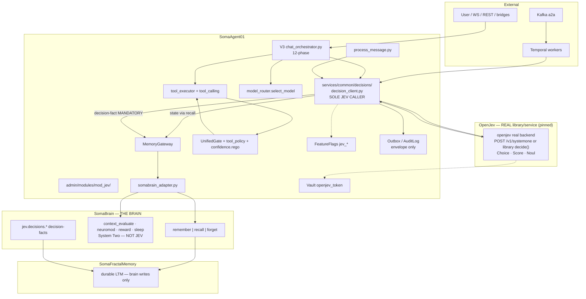

> **SUPERSEDED / RETIRED 2026-10-09.** OpenJev integration **removed** by operator order.
> Replacement: Cloudflare **Clef / Clef-flash** (Jev-API compatible) — see `SOMA-ARCH-CLEF-001`. Do not implement from this document.

# SOMA-ARCH-JEV-002 — Revised target architecture: OpenJev in the SomaAgent01 triad

## Document Control

| Field | Value |
|---|---|
| Document Title | Revised target architecture: OpenJev in the SomaAgent01 triad |
| Document Identifier | SOMA-ARCH-JEV-002 |
| Version | 1.1.0 |
| Date | 2026-10-09 |
| Status | Obsolete |
| Author | SomaTech Engineering |
| Approver | — |
| Classification | Internal |
| ISO Reference | ISO 9001:2015; ISO/IEC/IEEE 29148:2018; ISO/IEC 25010:2011 |
| Next Review | 2027-01-09 |
| Related | `SOMA-ARCH-CLEF-001` (replacement), `SOMA-ARCH-JEV-001`, `SOMA-PM-PLAN-JEV-INTEGRATION-001` (obsolete), `SOMA-ARCH-INVARIANTS-001`, `SOMA-ARCH-TOOLS-001` |
| Source of truth | Historical — superseded by `SOMA-ARCH-CLEF-001` |
| Audience | Historical reference only |
| Scope | Full revised architecture for OpenJev as System One decision layer. **OBSOLETE — OpenJev removed; use SOMA-ARCH-CLEF-001.** |

## Revision History

| Version | Date | Author | Description |
|---|---|---|---|
| 1.0.0 | 2026-10-09 | SomaTech Engineering | Revision after dual review. Fixes Noul↔confidence semantic bug (evaluator). Makes decision persistence **mandatory brain-only** (architect). Drops D-7 as persistence filter (product law). Adds capability placement matrix, OPA input contract, numeric thresholds, fail-closed matrix. |
| 1.1.0 | 2026-10-09 | triad-iso-docs | Retired. OpenJev removed by operator order. Status Draft → Obsolete. Superseded by `SOMA-ARCH-CLEF-001`. Historical record only — do not implement. |

---

## 0. Binding law

**Operator law (2026-10-09):** ALL data is saved and passed through THE BRAIN
(SomaBrain). T-1: agent never holds an SFM client.

```
agent → MemoryGateway → SomaBrain → SomaFractalMemory
```

No private memory. No JEV store. No side channel.
**If a JEV value must survive the process, it is a decision-fact in THE BRAIN — or it did not happen.**

Seam A (LLM slot): **EXCLUDED permanently.**

---

## 0.1 ABSOLUTE LAW — REAL CODE ONLY (operator, 2026-10-09)

**NO SHIMS. NO FAKES. NO MOCKS. NO STUBS. NO PLACEHOLDERS. NO TODO PASSES.**

A shim is a bypass. A mock is a lie. A fake is a defect (SOMA-AGENT-HANDOFF-001 Rule 4 / VIBE / T-8).
OpenJev is integrated as a **real** pinned dependency or a **real** `openjev serve` process — never a wrapper invented to fake an API.
Acceptance paths use live real backends only.

---

## 1. Executive verdict

| Field | Value |
|---|---|
| Is OpenJev a good choice? | **YES — narrow, 7.5/10 architect · 4.0/5 evaluator (CONDITIONAL GO)** |
| What it is | System One decision microservice: typed `Choice` / `Score` / `Noul` |
| What it is not | Chat LLM · memory store · policy engine · authz · brain |
| Primary home | **Real OpenJev dependency** (pinned library or real `openjev serve`) + **one** shared decision client |
| Enforcement floor | **OPA / UnifiedGate (unchanged)** |
| Memory / data | **SomaBrain → SFM (only store)** |
| Async / calibration | **Temporal / Kafka a2a** |
| First ship | **W-J0–W-J2 only** (pin, client + real OpenJev + brain write, guardrail choke) |

**One-line law:**

> **OPA enforces. V3 orchestrates. Temporal endures. SomaBrain remembers and thinks (System Two). OpenJev only decides small things — and every decision it makes is a fact in THE BRAIN, or it did not happen.**

---

## 2. Defects corrected vs v1 (`SOMA-ARCH-JEV-001`)

| # | Defect (found by review) | Correction (this doc) |
|---|---|---|
| **C-1** | v1 mapped `input.confidence = noul` | **WRONG.** `NoulAnswer` is `{noul: float}` = P(true) only (OpenJev `primitives.py:110–112`). P(safe) ≠ entropy confidence. **Split the contract** (§5) |
| **C-2** | v1 made decision-fact write “optional” | **WRONG** under product law. Persistence is **mandatory and brain-only** (§6) |
| **C-3** | D-7 “memory admission” filtered storage | **REMOVED** as a filter. Store-everything law. JEV may **annotate** salience, never gate persistence |
| **C-4** | Shared client “recommended” | **Mandatory sole JEV caller** (anti-F-3) |
| **C-5** | SomaBrain cognitive APIs not fenced | JEV **never** touches `context_evaluate`, neuromodulators, reward, sleep (System Two) |
| **C-6** | Effort 11–16 d optimistic | Realistic **15–25 d** for W-J0–W-J4 done properly (calibration, dual choke sites, evidence) |
| **C-7** | No numeric thresholds / OPA input schema | Added (§5.2, §5.3) |
| **C-8** | `jev_decide` tool in first ship | **Deferred** — second attack surface before choke is proven |

---

## 3. Target architecture



### 3.1 Hot path (tool boundary — P0 value)

```
User turn
  → V3 Phase 5  MemoryGateway.recall (context)
  → Phase 6     select_model (rules floor)
  → Phase 7     tools_for_llm (rules floor)
  → Phase 8–9   LLM + native tool_calls
  → ONE authorize choke (chat AND Kafka AND Temporal):
      1. UnifiedGate / tool_policy.rego     → deny = stop
      2. shared client → real OpenJev      → Noul p_safe + Score risk
      3. confidence.rego (§5 contract)      → allow | require_approval | deny
      4. decision-fact → MemoryGateway.remember → SomaBrain → SFM   [MANDATORY]
      5. outbox audit + RED metrics
  → tool_executor / PathGuard / Temporal activity
  → Phase 10 response · Phase 11 memory via MemoryGateway only
```

---

## 4. Capability placement matrix — who owns what

| # | Capability | **Owner** | Why | Who must NOT own it |
|---|---|---|---|---|
| 1 | Chat generation | **Chat LLM via V3** | Open generation | OpenJev · SomaBrain · Temporal |
| 2 | Tool selection | **V3 Phase 7 rules floor + JEV `Choice` rank (D-3)** | Closed-world over tool names | Chat LLM alone · OPA · SomaBrain |
| 3 | Tool guardrail/approval | **OPA enforce + JEV Noul/Score evidence (D-1/D-2)** | Fail-closed policy plane stays | OpenJev as enforcer · prompt-only · SomaBrain |
| 4 | Model routing | **`select_model` rules + JEV `Choice` tie-break (D-4)** | Deterministic constraints stay code | OpenJev sole router · LLM · Temporal |
| 5 | Urgency/severity triage | **JEV `Score` (D-5)** | Ordered legend is the primitive | Regex · chat LLM · `context_evaluate` |
| 6 | Escalation to human | **JEV `Noul` signal + `should_flag` + human authority** | Humans remain authority | Auto-close from JEV alone |
| 7 | Long-term memory | **SomaBrain → SFM (T-1)** | Product law | OpenJev · agent process · outbox-as-truth |
| 8 | Working/session state | **Brain namespace via MemoryGateway** | “No private memory” includes scratch | JEV memory · Temporal state · agent dicts |
| 9 | Decision audit | **Brain `jev.decisions.*` SoR + outbox envelope** | Survive = in brain | JEV logs · Prometheus · sidecar DB |
| 10 | Calibration / eval | **Temporal workers + brain-stored facts** | Offline, durable | In-turn JEV · laptop notebooks |
| 11 | Async batch scoring | **Temporal + delegation gateway + Kafka a2a** | Existing durable jobs | V3 hot path · second orchestrator |
| 12 | Cognitive context eval | **SomaBrain `context_evaluate`** | System Two | OpenJev · V3 reimplementation |
| 13 | Neuromodulators / reward | **SomaBrain** | Homeostasis is brain state | OpenJev · SA01 local hacks |

**Legend:** OpenJev = typed micro-decisions · OPA = enforce · V3 = interactive pipeline · model_router = constraints · Temporal = durable async · SomaBrain = all durable data + cognitive APIs · SFM = LTM (brain-writes-only).

---

## 5. OpenJev decision contract (C-1 fix)

### 5.1 Signal split — do not conflate

| OpenJev field | Meaning | Maps to |
|---|---|---|
| `NoulAnswer.noul` | **P(true)** e.g. P(safe) | `input.p_safe` (risk / allow signal) |
| `ScoreAnswer.score` | expectation on ordered scale | `input.risk` (severity) |
| `ScoreAnswer.confidence` | 1 − normalized entropy | `input.confidence` |
| `ChoiceAnswer.confidence` | 1 − normalized entropy | `input.confidence` |
| `ChoiceAnswer.choice` + `probabilities` | closed-world pick | router inputs / audit |

**Rule:** never feed `noul` into `input.confidence`. Mid-range P(safe) must not be mistaken for “model unsure.”

### 5.2 OPA input contract (normative)

```json
{
  "action": "tool.request",
  "tenant": "<uuid>",
  "resource": "<tool_name>",
  "confidence_enabled": true,
  "treat_null_as_low": true,
  "min_acceptance": 0.5,
  "p_safe": 0.12,
  "risk": 2.4,
  "confidence": 0.41,
  "confidence_status": "critical|low|acceptable",
  "jev_present": true,
  "jev_decision_id": "<brain-fact id>"
}
```

- `policy/confidence.rego` **partially** implements thresholds (`0.3` critical, `min_acceptance`, `should_flag`) but does **NOT** yet consume `p_safe`/`risk`/`jev_present` and has **no** `require_approval` outcome. W-J2 **must implement** those rules (ADV-JEV-07).
- Choke outcome enum today is `auto_execute | approval_required | denied` (`tool_calling.decide_and_authorize_tool`) — align naming; do not invent `require_approval` as a third synonym.

### 5.3 Numeric thresholds (first ship — calibrate later)

| Condition | Effect |
|---|---|
| `p_safe` **null** (JEV missing/down) and tool tier-3 | **deny** or **require_approval** (never silent allow) |
| `p_safe` **&lt; 0.30** | **deny** tier-3 · **require_approval** tier-2 |
| `p_safe` **0.30–0.70** | **require_approval** (human) |
| `p_safe` **&gt; 0.70** and `risk` **≤ 1** | allow (tier-1/2) |
| `risk` **≥ 2** | always **require_approval** regardless of p_safe |
| `confidence` **&lt; 0.30** | `should_flag` + treat as low evidence |

Until W-J4 calibration: **tier-3 always keeps human approval** even at high p_safe (R-4).

---

## 6. Brain-only persistence (product law)

| Data | Write (only) | Read (only) |
|---|---|---|
| User turns / replies | V3 Phase 11 → MemoryGateway → SomaBrain → SFM | Phase 5 recall |
| Working state | MemoryGateway `session.working.*` | MemoryGateway |
| JEV input `state` | built by caller | MemoryGateway.recall |
| **JEV decision-fact** | **Shared client → MemoryGateway `jev.decisions.*` + outbox envelope** | recall / UI / calibration |
| Calibration sets | Artifacts summarized → brain | Temporal via recall |

**No JEV disk, DB, Redis, or decision cache.** OpenJev call is stateless.

If outbox OK and brain write fails ⇒ decision **not saved** ⇒ retry/DLQ; tier-3 stays blocked. Brain is system of record.

### Decision-fact schema

```
decision_id, tenant_id, trace_id, mode(choice|score|noul), question_id,
payload{choice|score|noul, probabilities, confidence}, input_state_digest,
caller(v3|conversation_worker|temporal), model_id, latency_ms,
outcome(allow|require_approval|deny|advisory), opa_decision_ref, created_at
```

---

## 7. OpenJev boundary — MUST NEVER

1. Occupy the LLM slot (Seam A).
2. Hold an SFM client (T-1).
3. Call SomaBrain directly (OpenJev is stateless per call).
4. Own any store.
5. Enforce authorization (advises only; OPA/UnifiedGate enforce).
6. Invent labels (closed world, ≥2 options).
7. Write monologue/free text as fact.
8. Call tools, send mail, start workflows, publish Kafka.
9. Handle secrets in payloads (args_digest only).
10. Add a silent second LLM pass on the chat path.

---

## 8. Integration seams (live attach points)

| Seam | Path | Attach |
|---|---|---|
| C module shell | `admin/modules/mod_jev/` (mod_email pattern) | `module.yaml`, flags, Ninja `/api/v2/modules/mod_jev/*` |
| Shared client | `services/common/decisions/decision_client.py` | **sole** `decide()` |
| B choke | `admin/core/tool_calling.py`, `services/tool_executor/{execution_engine,request_handler}.py` | one choke, all pipelines |
| OPA feed | `policy/tool_policy.rego`, `policy/confidence.rego` | `p_safe`, `risk`, `confidence` |
| Model tie-break | `admin/core/model_router.py` | D-4 when \|candidates\|&gt;1 |
| V3 hooks | `admin/core/chat_orchestrator.py` Phases 5/6/7/11 | D-5 triage, decision-facts |
| Dual parity | `process_message.py`, conversation worker | same client |
| Seam D | `services/delegation_gateway/*`, `schemas/delegation_task.json`, Kafka `a2a` | async eval/calibration |
| T-1 memory | `memory_gateway.py` → `somabrain_adapter.py` | ALL JEV I/O |
| Secrets | Vault `secret/agent/credentials/openjev_token` | no hardcoded keys |
| Flags | **one store:** Django `FeatureFlag` via `admin.core.config.registry.get_feature_flag` (default False) | unset/off ⇒ **deny tier-3** |
| OpenJev runtime | Real pinned OpenJev dependency (library `get_backend('hf')`) or real `openjev serve` HTTP when upstream ships it | NO wrapper/shim layer |

**Named choke insertion points (must both call the same helper):**

1. Chat path — authorize before `execution_engine` / `tool_calling` allow.
2. Kafka path — `services/tool_executor/request_handler.py` (already shares policy choke).
3. Temporal activities that execute tools — same helper.

---

## 9. Tradeoffs vs alternatives

| Alternative | Verdict vs OpenJev |
|---|---|
| Pure LLM micro-decisions | **Reject as guardrail** — untyped, slow, prompt-injectable |
| Pure OPA rules | **Keep as enforcer** — no P(safe)/severity; `confidence.rego` needs a producer |
| Fine-tuned classifier | Later if JEV accuracy lags; slower multi-task iteration |
| Brain-side `decide()` | **Reject as runtime home** — brain stores facts; does not run the forward pass |
| Do nothing | **Reject** — F-1/F-2 real production risk |

---

## 10. Risks + fail-closed matrix

| ID | Risk | Fail-closed |
|---|---|---|
| R-1 | Phase 0 API drift | Pin SHA; contract tests; schema break = JEV-down |
| R-2 | Latency | Tool-boundary only; timeout ⇒ deny/approval tier-3 |
| R-3 | Dual pipeline | One shared client + test |
| R-4 | Entropy ≠ calibrated | Tier-3 human approval until W-J4 |
| R-5 | Prompt-only creep | Code-gate; tests fail if flag on and call missing |
| R-6 | Fat state blobs | Compact state; args_digest; no monologue |
| R-7 | Flag misconfig | Unset ⇒ deny tier-3 |
| R-8 | Brain write lost | DLQ; block tier-3 until persisted |
| R-9 | OpenJev process exfil | No secrets in state; OpenJev service has **no** brain/SFM creds |
| R-10 | “JEV says yes” social eng. | UI shows probs **and** OPA rationale; override needs reason |
| R-11 | Mock in acceptance | T-8/VIBE: HF/production pin only |
| R-12 | SomaBrain SPOF | Existing triad risk; circuit breaker on gateway |

| Condition | D-1/D-2 guardrail | D-3/D-4 router | D-5 triage | D-6 escalation |
|---|---|---|---|---|
| Flag off | legacy | rules | skip | if-chains |
| JEV down/timeout | **deny/approval** tier-3 | rules | skip | `should_flag` |
| Brain write failed | block tier-3 | discard advisory | discard | discard + metric |
| OPA/UnifiedGate deny | **stop before JEV** | — | — | — |

**Invariant:** JEV can only **tighten** dangerous actions vs legacy. Loosening requires human override that is itself a brain-persisted decision-fact.

---

## 11. When NOT to use OpenJev

1. Free-text generation/extraction — forever (Seam A).
2. Authorization alone — OPA/UnifiedGate only.
3. Long-context understanding — chat LLM + `context_evaluate`.
4. Open-ended label domains (e.g. pick among 10k memories) — SomaBrain retrieval.
5. Sub-5 ms hard real-time in HF mode.
6. Cannot afford ~300 ms tool-boundary budget and cannot go async.
7. As second memory / orchestrator / policy engine.
8. If the team cannot enforce a single shared client.

---

## 12. Phased rollout (evaluator scope-cut applied)

| Phase | Work | Exit |
|---|---|---|
| **H.0** | Contract freeze + SHA pin + A2A claims + close F-6 residual SFM debt | Schema + claims locked |
| **W-J1** | Shim + `mod_jev` + shared client + **mandatory brain write** | Decision-fact recallable; no JEV residue |
| **W-J2** | **P0 guardrail choke** D-1/D-2 + OPA contract + audit | Golden set; tier-3 visible allow/deny/approval |
| **W-J3** *(defer until W-J2 evidence)* | D-5/D-6 then D-3/D-4 | Urgency badge; ranked tools |
| **W-J4** | Temporal calibration + `openjev serve` swap prep | Calibration report; JEV-R evidence |

**First ship = H.0 + W-J1 + W-J2 only.**  
**No `jev_decide` tool in first ship.** No D-8 intent routing. No D-7 persistence filter.

Estimate: **15–25 person-days** for full W-J0–W-J4; **~6–9 days** for first ship.

---

## 13. Review scores (dual independent)

| Source | Score | Verdict |
|---|---|---|
| `architect` | **7.5 / 10** | Adopt with strict boundaries; P0 guardrail first |
| `agent-evaluator` | **4.0 / 5** (20/25) | **CONDITIONAL GO** W-J0–W-J2 after confidence-contract fix (now done in §5) |

Evaluator conditions: fix confidence mapping ✓ (this doc) · OPA remains enforcer ✓ · pin SHA ✓ (H.0) · fail-closed ✓ · drop D-7 filter ✓ · single client ✓ · tier-3 human approval ✓ · defer `jev_decide` tool ✓.

---

## 14. Recommendation to the operator

**OpenJev is a good addition** if and only if you accept this placement:

| Use completely | Use SomaBrain for | Use the rest for |
|---|---|---|
| Shared decision client · real OpenJev · guardrail Noul/Score · later triage/escalation/router | **ALL data & memory** · decision-facts · cognitive APIs · working state | OPA enforce · UnifiedGate authz · Temporal async · chat LLM language · model_router constraints |

**Approve direction, then release G-0 for H.0 + W-J1 + W-J2.** Do not expand scope until golden-set evidence exists.

*End of document — SOMA-ARCH-JEV-002 v1.0.0*
